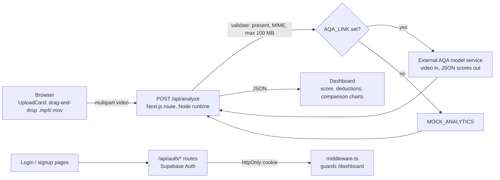

# Splash

Web app for AI-assisted diving judging. A coach or athlete uploads a dive video, the app sends it
to an action quality assessment (AQA) model, and the dashboard shows an execution score and
per-error breakdown: feet separation, body straightness on entry, splash, and somersault position.

**Scope of this repo.** This is the product layer: the Next.js frontend, Supabase auth, and the
upload/validation API that forwards videos to the model. The computer-vision model itself is not
in this repository. It runs as a separate HTTP service whose URL is set in `AQA_LINK`. Without that
variable, the API returns mock scores so the UI can be developed and demoed on its own.

## How it works



### Upload and validation layer (`src/app/api/analyze/route.ts`)

| Check | Failure response |
|---|---|
| form field `video` present and a file | 400 |
| MIME type is `video/mp4` or `video/quicktime` | 415 |
| size <= 100 MB | 413 |
| model service returns non-2xx | 502 with a user-facing message (details logged server-side) |
| any other exception | 500 |

The route re-packages the file into a fresh `FormData` (field `video`) and POSTs it to `AQA_LINK`.
The browser never sees the model endpoint. The client (`UploadCard`) also rejects non-video files
before uploading.

### Model contract

The dashboard expects this JSON from the model service (`src/types/analytics.ts`):

```json
{
  "overall_score": { "raw_score": 87.4 },
  "error_scores": {
    "feet_apart": { "interpretation": "No deduction — feet remained together throughout entry." },
    "straightness_during_entry": { "percentile": 82 },
    "splash": { "max_splash_frame": 147 },
    "som_position_tightness": { "position": "Pike" }
  }
}
```

| Field | Meaning |
|---|---|
| `overall_score.raw_score` | execution score; values above 10 are treated as a 0-100 scale and divided by 10 for display |
| `feet_apart.interpretation` | text verdict on feet separation |
| `straightness_during_entry.percentile` | body-line straightness at water entry, as a percentile |
| `splash.max_splash_frame` | frame index of the largest splash |
| `som_position_tightness.position` | somersault position detected (e.g. Pike, Tuck) |

Any model that accepts a multipart `video` field and returns this shape can be plugged in by
setting `AQA_LINK`. The values above are the repo's mock response, not model output.

### Dashboard (`src/app/dashboard/page.tsx`)

After an upload, the dashboard shows a score card, a deduction card (feet), an entry-performance
card (straightness percentile), a splash card and a form card (position), plus Recharts views:
a score doughnut and a comparison of the current dive against three built-in sample dives
(`src/lib/mock-data.ts`, scores 8.7 / 9.8 / 5.4).

### Auth

Supabase Auth behind Next.js API routes (`/api/auth/signup`, `login`, `logout`, `user`, `profile`,
`update-password`, `reset-password`). Login stores the access token in an httpOnly,
`sameSite=lax` cookie (`secure` in production, 7 days). `middleware.ts` redirects to `/login` when
that cookie is absent on `/dashboard` or `/profile`. A `users` profile table with row-level
security and a sign-up trigger is described in [`SUPABASE_SCHEMA.md`](SUPABASE_SCHEMA.md).

## Stack

Next.js 16 (App Router) and React 19, TypeScript, Tailwind CSS 4, Radix UI / shadcn components,
Framer Motion, Recharts, Supabase JS, Vercel Analytics.

## Run locally

```bash
npm install
npm run dev                  # http://localhost:3000
```

`.env.local`:

```bash
NEXT_PUBLIC_SUPABASE_URL=https://<your-project>.supabase.co
NEXT_PUBLIC_SUPABASE_ANON_KEY=<your-anon-key>
NEXT_PUBLIC_APP_URL=http://localhost:3000     # used for password-reset redirects
AQA_LINK=https://<your-aqa-service>/analyze   # optional; leave unset for mock scores
```

The Supabase variables are required (`src/lib/supabase.ts` throws at import without them).
There is no `.env.example` in the repo yet, so create `.env.local` directly. Set up the
profile table with the SQL in `SUPABASE_SCHEMA.md`; the other `SUPABASE_*.md` and
`SETUP_CHECKLIST.md` files cover the auth setup in more detail.

Other scripts: `npm run build`, `npm run start`, `npm run lint`.

## Limitations and next steps

- **The CV model is external and not included.** Scores shown without `AQA_LINK` are mock data.
- The model response is passed to the browser without schema validation; a Zod schema for
  `AnalyticsResponse` (Zod is already a dependency) would turn a malformed reply into a clear error.
- `/api/analyze` itself does not check the session, and the middleware checks only that the
  cookie exists, not that the token is valid. Verifying the token server-side would keep
  anonymous clients from using the model endpoint.
- The 100 MB file is buffered in memory by the route before forwarding; streaming or direct
  upload to storage would scale better.
- The password-reset email redirects to `/auth/reset-password`, but there is no page at that path yet.
- The landing page describes features that are not implemented in this repo (judge panels,
  bias detection, tamper-proof scores, multi-role access, competition management, and the
  "7 judges per dive" / "<1s" stats). Today the working flow is single-video upload -> scores.
- `mongoose` and `bcrypt` are listed in `package.json` but not used.
